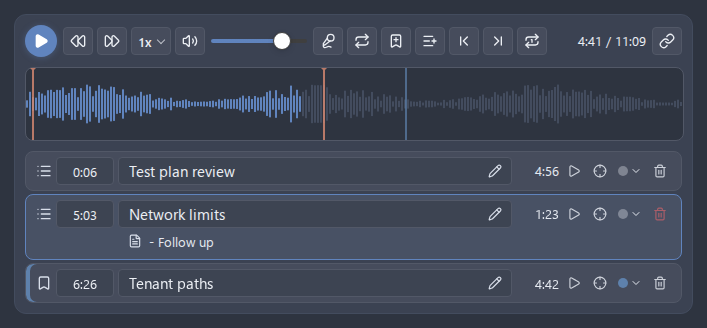
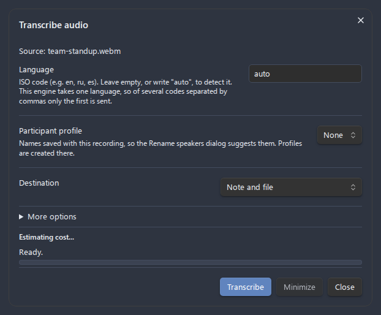

# Advanced Audio Recorder for Obsidian — long-meeting fork

> **This is a fork** of [akhmialeuski/advanced-audio-recorder](https://github.com/akhmialeuski/advanced-audio-recorder),
> tuned for **long offline meeting transcription**: 30–60 minute meetings
> recorded in a vault, transcribed locally by whisper.cpp with speaker labels,
> and none of your audio leaving the machine. It tracks upstream releases
> (currently 2.2.3 — all upstream features included) and adds the pieces a
> long meeting needs.

| Fork addition | What it fixes |
| --- | --- |
| **Chunked local transcription** (240 s runs, `--max-context 0`) | A whole-meeting whisper.cpp run eventually locks onto one phrase and repeats it for minutes. Short independent runs don't. |
| **Anti-hallucination decoder thresholds** (`--entropy-thold 2.6 --logprob-thold -0.8 --no-speech-thold 0.5`) | On silence, room noise, faint far-mic speech, or a TV in the background, default thresholds let the decoder fill non-speech stretches with a repeated phrase — a real 44-minute meeting lost ~8 minutes of demo narration under a phrase loop. With these thresholds the same audio transcribes as the actual speech (or nothing, when it truly is silence). |
| **ffmpeg container conversion** | 30+ minute webm/m4a recordings decode through desktop ffmpeg instead of the renderer's memory-bounded WebAudio, which dies on long meetings. |
| **Offline speaker diarization** | A bundled pyannote-based script ([`diarizer/`](diarizer/README.md)) labels segments by speaker after local transcription — 100% offline, no Hugging Face token (ungated model mirror), and it works at conference-room mic distance where voice-similarity diarization collapses. |
| **Speaker rename from the transcript** | Click a speaker label in the transcript to rename that speaker everywhere via a modal. |
| **Append fallback for transcript insertion** | If the target note isn't open in an editor, the transcript is appended to the file instead of being silently dropped. |
| **Adjacent-duplicate segment merge** | Chunk-boundary residue (the same sentence twice) is collapsed on the merged timeline. |

On an Apple-Silicon Mac, a 44-minute meeting transcribes locally in about
3 minutes with `ggml-large-v3-turbo`.

## Installation

### Via BRAT (recommended — gets fork updates)

1. Install [BRAT](https://github.com/TfTHacker/obsidian42-brat) from the
   community plugins.
2. If you already use the original plugin from the community store,
   **disable and remove it first** (same plugin id — they cannot coexist).
3. BRAT → **Add Beta plugin** → paste: `KYankee6/advanced-audio-recorder-fork`
4. Enable "Advanced Audio Recorder" and restart Obsidian.

### Manual

Download `main.js`, `manifest.json` and `styles.css` from the
[latest release](../../releases/latest) into
`<vault>/.obsidian/plugins/advanced-audio-recorder/`, then enable the plugin.

### Local whisper.cpp setup

1. `brew install whisper-cpp ffmpeg` (or your platform's equivalents).
2. Download a GGML model, e.g.
   [ggml-large-v3-turbo.bin](https://huggingface.co/ggerganov/whisper.cpp/resolve/main/ggml-large-v3-turbo.bin)
   (~1.6 GB), into `~/.cache/whisper/`.
3. Settings → Transcription:
   - Engine: **Local whisper.cpp**
   - Binary path: e.g. `/opt/homebrew/bin/whisper-cli`
   - Model path: e.g. `~/.cache/whisper/ggml-large-v3-turbo.bin`
   - Language: pin your meeting language (e.g. `ko`) — this also stops
     language misdetection on quiet intros.
4. For speaker labels, see [`diarizer/README.md`](diarizer/README.md):
   one venv (`pip install -r diarizer/requirements.txt`), then point the
   "Local diarizer" settings at that python and `diarizer/diarize.py`.

## (한국어) 장회의 녹음용 포크

원본 플러그인의 포크로 **긴 오프라인 회의 전사**에 맞춰 조정했습니다.
30~60분 회의를 녹음하면 whisper.cpp가 로컬에서 전사하고 화자 라벨까지
붙입니다. 음성은 100% 오프라인입니다.

포크 추가 사항: ① 240초 청크 분할 전사(긴 녹음 한 번 실행 시 발생하는
문구 반복 루프 방지) ② 검증된 환각 억제 임계값(무음·잡음·TV 소리 구간을
반복 문구가 아니라 실제 발화로 전사) ③ 30분+ webm의 ffmpeg 변환
④ 오프라인 화자분리(`diarizer/`, HuggingFace 토큰 불필요) ⑤ 전사에서 화자
이름 일괄 변경 ⑥ 노트가 닫혀 있어도 전사 폴백 삽입.

설치: BRAT에서 "Add Beta plugin"에 이 저장소(`KYankee6/advanced-audio-recorder-fork`)를
등록하세요. 커뮤니티 스토어의 원본을 쓰고 있다면 먼저 제거해야 합니다(같은
플러그인 id). whisper.cpp·화자분리 설정은 위 영문 섹션을 따라주세요.

---

# About the plugin

Advanced Audio Recorder lets you record, play, clean up, and transcribe audio directly inside [Obsidian](https://obsidian.md).

Use it for voice notes, meetings, interviews, lectures, and dictation. [Record](docs/recording.md) audio with one click, play it back in an [enhanced waveform player](docs/audio-player.md), add bookmarks and chapters, [split](docs/splitting.md) or [convert](docs/formats.md) files, and [clean up](docs/audio-cleanup.md) noisy recordings when needed.

The plugin also includes [built-in transcription](docs/transcription.md). You can transcribe recordings or existing audio files in your vault using the OpenAI-compatible Whisper API (OpenAI, Groq, and other hosts), Deepgram, Google Gemini, Mistral Voxtral, or a local offline whisper.cpp model. Transcripts can include speaker labels, clickable timestamps, and an optional [AI summary](docs/llm-post-processing.md) saved next to your note.

All audio and generated files stay in your vault. API keys are kept in Obsidian's keychain on each device; a key an earlier version stored in the plugin's settings file leaves it at the next restart of Obsidian. Keys are never sent anywhere except to the providers you choose, which are the transcription engine a run uses and, when post-processing is on, the LLM vendor it calls.

Works on desktop and mobile (iOS and Android). Some features are desktop-only (multi-track recording, local whisper.cpp transcription, input device selection); see [Mobile support](docs/mobile-support.md) for the platform differences. Requires Obsidian 1.14.4 or newer. MIT licensed.

The full documentation lives in the [docs](docs/index.md) folder, and the same link is built into the plugin's settings tab.

## Features

- Recording: one-click capture with pause, resume, live status feedback, automatic splitting of long sessions, and crash recovery. Record in stereo or mono - including keeping just one channel of a dual-input audio interface.
- System audio: record this computer's own output beside the microphone with one switch, so the remote participants of a call reach the recording (Windows, macOS 14.2 or later).
- Multi-track recording: capture up to eight input devices at once for multi-microphone interviews.
- Enhanced audio player: inline waveform with adjustable speed, skip, loop, volume, a voice-boost toggle that applies the cleanup chain to the recording as it plays, per-recording bookmarks, chapters, and clickable timestamp links.
- Transcription: OpenAI-compatible Whisper API, Deepgram, Google Gemini, Mistral Voxtral, or fully offline whisper.cpp, with speaker diarization and JSON, SRT, WebVTT, or plain-text output.
- LLM post-processing: optionally clean up or summarize any transcript with OpenAI, Anthropic, Gemini, Mistral, or DeepSeek.
- Recording panel: a sidebar tab with the details of the recording in front of you - duration, format, transcription, participants - and its actions one click away.
- Quick notes: dictate into the note at the cursor from a ribbon button, with the audio never saved and an optional LLM rewrite from a profile of your own.
- Audio cleanup: high-pass filter, noise gate, and loudness leveling, written to a fresh copy.
- Formats and file operations: convert between WAV, WebM, OGG, MP3, MP4, M4A, AAC, and FLAC (with an optional mono downmix), and split long files from the right-click menu.
- Command line (desktop): every action of the plugin is a terminal command too - record, transcribe into a note, name speakers, chapter, split, mark, drive the queue - and every one is also a palette command and a context-menu entry, defined once.

Recording is fast and forgiving. Start and stop from the ribbon or a command, follow live feedback in the status bar, and pause or resume without losing anything. Capture up to eight input devices at once for multi-microphone interviews, let long sessions split into fixed-length parts automatically, and recover the audio on the next launch if Obsidian closes mid-recording. See [Recording](docs/recording.md) and [Multi-track recording](docs/multi-track-recording.md).

The enhanced player turns playback into a first-class part of your notes. Recordings embed as a player with a clickable waveform, adjustable speed, skip, loop, and volume. Add per-recording bookmarks and chapters, move between them, and copy timestamp links that jump straight to a moment in the audio. See the [enhanced audio player](docs/audio-player.md).

Transcription turns any recording, or any audio file already in your vault, into text with the engine that fits your needs: the OpenAI-compatible Whisper API (Groq and other compatible hosts included), Deepgram, Google Gemini, Mistral Voxtral, or a fully offline `whisper.cpp` model that never touches the network. Deepgram, Gemini, and Voxtral add automatic speaker diarization, so meetings and interviews come back labelled by speaker — and the fork extends the offline local engine with its own diarizer (see [`diarizer/`](diarizer/README.md)). You decide where the transcript goes and in which format (JSON, SRT, WebVTT, or plain text), with timestamps you can click to jump the player to the right moment. An optional pass through an LLM (OpenAI, Anthropic, Gemini, or Mistral) cleans up the wording or condenses the transcript into key points and action items. See [Transcription](docs/transcription.md) and [LLM post-processing](docs/llm-post-processing.md).

Everything else keeps your audio tidy. Convert recordings between WAV, WebM, OGG, MP3, MP4, M4A, AAC, and FLAC, and split long files into parts straight from the right-click menu; the formats you can record in are the subset your platform supports. Clean up noisy audio on demand with a high-pass filter, noise gate, and loudness leveling, always written to a fresh copy so the original is left untouched. See [Formats](docs/formats.md), [File operations](docs/file-operations.md), and [Audio cleanup](docs/audio-cleanup.md).

## Quick start

1. Click the microphone icon in the left ribbon, or run "Start/stop recording" from the command palette.
2. Speak, then click again to stop.
3. The recording is saved to your vault and embedded in the active note.

No default hotkeys are assigned. Set your own in Settings, under Hotkeys.

## Privacy and permissions

- **Network.** Audio and text leave your device only for the transcription and LLM engines you set up, and only when you run them. The local `whisper.cpp` engine makes no network request. The plugin has no telemetry.
- **Files in your vault.** Two features list the vault's files: the marker search, which looks for the `.markers.json` sidecars that hold each recording's markers, and the folder transcription command, which offers the folders that hold recordings. Neither reads a file it was not looking for, and nothing is sent anywhere. Transcript lookup reads only the recording's own folder.
- **Deleting files.** Every file the plugin removes, a split's leftover parts and an emptied sidecar included, goes where Obsidian's **Deleted files** setting sends deleted files.
- **Clipboard.** The plugin writes to the clipboard and never reads from it. It does so when you click a copy action (a timestamp link, a chapter outline, file info, the diagnostics report), and when a quick note finishes while no note is open to take its text.

## Support

All credit for the original plugin goes to
[Anatol Khmialeuski](https://github.com/akhmialeuski) — if the plugin saves
you time, please support [his funding page](https://coff.ee/akhmelevskiy).

## Troubleshooting and bug reports

If something is not working, start with the [troubleshooting guide](docs/troubleshooting.md). For problems specific to this fork (local chunked transcription, thresholds, offline diarization), open an issue on [this fork](../../issues); for anything else, follow the [bug reporting guide](docs/BUG_REPORTING_GUIDE.md) and open an issue on [the upstream repository](https://github.com/akhmialeuski/advanced-audio-recorder/issues).

## License

Released under the [MIT License](LICENSE).

<!-- Keywords for search: obsidian audio recorder, obsidian voice recorder, obsidian dictation, record audio in obsidian, microphone recorder, multi-track recording, meeting recorder, interview recorder, lecture recorder, audio converter, wav mp3 flac ogg webm m4a aac, waveform audio player, audio bookmarks and chapters, speech to text, transcription, Whisper, OpenAI, Groq, Deepgram, Google Gemini, Mistral Voxtral, whisper.cpp offline transcription, speaker diarization, transcript SRT VTT, LLM summary, voice memo plugin. -->
